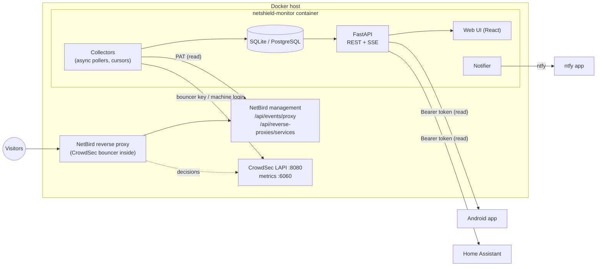

# Architecture

## Data flow

1. **NetBird access log collector** (every 30 s): fetches new proxy events in ascending order from a persisted
   cursor, normalises them, classifies each request and stores it. Duplicate ids are ignored, so overlapping
   polls and restarts are safe. On first start it backfills the NetBird retention window (default 7 days).
2. **Services collector** (5 min): syncs domains and their CrowdSec mode.
3. **CrowdSec alerts** (60 s), **decisions** (2 min), **metrics** (5 min).
4. **Maintenance** (10 min): daily visitor counts, retention clean-up, deletion of expired visitor salts.
5. **Notifier** (60 s): evaluates thresholds, deduplicates, delivers via ntfy, publishes SSE events.

Every collector records its status (`ok`, `backfill`, `error` + user-facing message, last success) – visible in
the UI, the API (`/api/v1/sources`) and Home Assistant (`binary_sensor.netshield_source_problem`). A failing source
never stops the others; collectors retry with exponential back-off.

## Request classification

| Category | Rule |
|---|---|
| `blocked` | CrowdSec ban enforced by the NetBird proxy |
| `challenged` | CrowdSec captcha served by the proxy |
| `internal` | source IP in private/NetBird/configured internal networks |
| `suspicious` | scanner path patterns or CrowdSec verdict in observe mode |
| `visitor` | everything else |

**Requests ≠ visitors.** Visitors are distinct pseudonyms of `visitor`-category requests per local day:
`HMAC-SHA256(daily_random_salt, ip)`. The salt is deleted after the day has ended, making the pseudonyms
unlinkable. Over multi-day ranges the daily values are summed (visitor-days).

## Data model (simplified)

| Table | Content | Retention |
|---|---|---|
| `proxy_requests` | one row per request (truncated IP, pseudonym, country, category, verdict) | 14 days |
| `hourly_stats` | counts per hour × host × country × status × category | 365 days |
| `daily_visitors` | visitors per day and host | 365 days |
| `domains` | discovered/manual domains, CrowdSec mode | – |
| `crowdsec_alerts` | normalised alerts (truncated source) | 90 days |
| `crowdsec_decisions` | snapshot of active **local** decisions | replaced every poll |
| `crowdsec_decision_counts` | active decision totals per origin/type over time | 14 days |
| `metric_samples` | selected Prometheus counters | 14 days |
| `notifications` | everything sent to ntfy/SSE/HA/app | 90 days |
| `admin_users`, `sessions`, `api_tokens`, `settings` | auth & runtime settings (hashes only) | – |

Short ranges (≤ 48 h) are computed from raw rows with minute precision, longer ranges from hourly aggregates.

## Authentication

- **Web UI:** local admin, Argon2id password hash, HttpOnly + SameSite=Strict session cookie, CSRF token header for
  state-changing requests, login throttling.
- **Android / Home Assistant:** `nsm_…` bearer tokens, stored as SHA-256 hashes, scope `read` or `admin`, revocable.
- Upstream credentials (NetBird PAT, CrowdSec keys) are only read from secret files/env and never returned by any endpoint.
